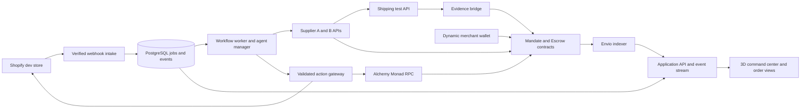

# AfterOrder — master implementation specification

Version 1.0 · 14 September 2026 · Owner: Om Thakur

Status: reference specification. A working local MVP now implements the canonical workflow;
see `README.md` and `docs/09-IMPLEMENTATION-STATUS.md` for verified scope and remaining setup.
This file remains the single specification for the build. Earlier files under `docs/`
record exploration; where they disagree, this document takes precedence. In particular,
returns-only AfterOrder is superseded by autonomous sourcing and fulfilment. The name remains
AfterOrder as a working project title; no portal submission or trademark clearance is implied.

## Contents

1. Product, problem and success criteria
2. Scope, personas and operating assumptions
3. Complete user and agent journey
4. Functional requirements
5. Nonfunctional requirements and budgets
6. Architecture and system choices
7. Agent responsibilities and tool contracts
8. Blockchain contracts, authority and escrow
9. Shopify, suppliers, shipping and other integrations
10. Persistent data, events and state machines
11. API and frontend contracts
12. 3D interface and interaction design
13. Identity, secrets and operational controls
14. Failure handling and reconciliation
15. Repository structure and commands
16. Test strategy and acceptance matrix
17. Local setup, deployment and observability
18. Execution plan and ownership
19. Primary track, all sponsor bounties and resource plan
20. Demo script and submission package
21. Build-agent handoff and definition of done
22. Sources, remaining external facts and decision log

## 1. Product, problem and success criteria

### Name and positioning

**AfterOrder**

Tagline: **From order to fulfilment, with agents accountable for every purchase.**

One sentence: AfterOrder connects a Shopify order to a team of purchasing agents that compare
supplier offers, reserve inventory, fund an order-specific escrow on Monad, coordinate shipping
and update Shopify, with the complete journey visible in a 3D command center.

The primary user is a small merchant purchasing from participating suppliers. The prototype is
one merchant, two participating supplier services and one product family. The supplier services
are built and operated by the team, with separate keys and persistent inventories. Present them
as sandbox supplier integrations, not existing commercial partners or independent companies.

### Problem statement

When a store must source a paid order from a supplier, an operator checks stock, compares prices
and delivery promises, arranges payment, follows up on shipment and updates the store. If the
preferred supplier cannot fulfil the order, the operator repeats that work. Buyer and supplier
also need a shared record of what was agreed and when payment becomes available.

AfterOrder automates that defined purchasing workflow under standing merchant instructions.
The problem's frequency and savings remain hypotheses until measured with merchants. Do not
claim market traction, a quantified cost reduction or a production partnership from fixtures.

### What agents contribute

Agents interpret supplier terms, plan bounded work, ask tools for missing information, compare
permitted options and replan after failures. Code validates arithmetic, permissions, deadlines,
state transitions and signatures. Multiple agents are justified by different tools and concurrent
work, not by creating different names for identical prompts.

### What blockchain contributes

The merchant deposits settlement tokens into an escrow controlled by a contract. A limited
execution key can reserve funds only under the merchant's mandate. Supplier-signed quotes and
acceptance establish the exact counterparty and amount. A designated evidence signer attests
that the agreed shipment milestone occurred; the contract releases the reserved funds once.
The supplier can inspect the escrow without trusting the merchant application's database.

The chain enforces custody, spending constraints and state transitions. It does not certify
physical delivery, evaluate natural-language policies or block a Shopify credential holder from
calling Shopify directly. External evidence signers and API credential holders are explicit trust
boundaries. The prototype assumes payment on dispatch, not on final customer delivery.

### Success criteria

- One actual Shopify development-store paid-order event starts the workflow automatically.
- The system compares offers from two separately running supplier services.
- A real supplier reservation failure causes an automatic switch before irreversible purchase.
- A Monad testnet contract receives, locks and releases test settlement tokens.
- A supplier acceptance and shipment milestone are attributable to the configured signers.
- Shopify contains the correct fulfilment record and tracking information when ready to ship.
- The 3D interface and a readable event list display the same persisted events.
- No employee clicks approve during the configured normal scenario.
- Duplicate events and retries produce no duplicate reservation, escrow release or fulfilment.
- Normal workflow works after worker restart and browser refresh.
- A second minimal consumer script can verify/use the contract interface without AfterOrder UI.

## 2. Scope, personas and operating assumptions

### Included in the complete hackathon build

Shopify integration; merchant onboarding; inventory/product mapping; two supplier services;
bounded multi-agent orchestration; merchant budget and delegated authority; quote signatures;
supplier escrow; an evidence bridge; shipping test integration; Shopify reconciliation; Dynamic
wallet onboarding; Alchemy RPC; Envio event indexing; a central 3D manager and specialist desks;
notifications; activity history; restart recovery; automated tests; deployment and demo packaging.

### Boundaries that make completion well-defined

- One SKU and one shipment per order in the demonstration; reject unsupported multi-SKU orders
  with a clear reason before spending. The schema supports more lines for future expansion.
- Exact mapped product variants only. An agent cannot substitute color, size or specifications.
- Same-country synthetic addresses; international duties are excluded from this prototype.
- Quote amount is all-in for supplier item and shipping cost. Do not silently add fees afterward.
- Retail customer payment stays in Shopify test mode; supplier payment uses mock tokens on Monad
  testnet. These are two separate ledgers and are never described as bridged money.
- Physical production, packing, transit and inspection are external activities. Sandbox events
  may accelerate these for a demo and must be labeled accordingly.
- Returns, repair, insurance, marketing, lending and speculative trading are later product scope.
- No dependency on Amazon, Printify or Printful accepting onchain payment. They are not integrated
  in this version. Shopify plus the shipping test API are the third-party operational integrations.

### Personas

Merchant owner: connects Shopify, maps products, funds a budget, permits suppliers and defines
maximum purchase cost/deadlines. Can pause new purchases, revoke authority and inspect evidence.

Customer: buys through the Shopify storefront and receives the normal order/tracking experience.
Does not need a crypto wallet, know agent names or approve the merchant's supplier payments.

Supplier: publishes mapped stock and signed offers, verifies funded escrow, accepts an order,
prepares shipment and submits evidence. The demo supplies two sandbox services implementing this.

Viewer/judge: sees a read-only, redacted 3D workspace and transaction/order evidence.

Operator: handles cases beyond the standing mandate, compromised credentials or genuine disputes.
There is no artificial approval button in the normal flow, but unresolved external facts remain
unresolved rather than being guessed by a model.

### Definition of autonomy

Initial permissions, deposits and product mapping require merchant setup. Once configured, valid
orders progress automatically. A supplier timeout may lead to another approved supplier. No
acceptable offer leads to `BLOCKED_NO_VALID_OFFER`; the system does not raise budgets or change
customer intent. Existing funded obligations still need to settle after new-purchase authority
is revoked. Restarting an agent does not restart its spending allowance.

## 3. Complete user and agent journey

### One-time setup

1. Merchant signs in through Dynamic and establishes an application session.
2. Backend verifies identity and wallet ownership. Connect the authorized Shopify dev store.
3. Configure one merchant-managed fulfilment location, one product/SKU mapping and approved
   supplier keys. Supplier endpoints are explicitly allowlisted.
4. Show the mandate in readable language and exact token units. Merchant approves the token
   allowance, deposits demo tokens and creates the root mandate using their wallet.
5. Register the manager execution address; manager delegates a narrower child mandate to the
   purchasing signer. Execution keys receive only gas tokens, not the owner's wallet authority.
6. Run connection checks for Shopify, suppliers, RPC, indexer, shipping and the model provider.
7. Show Ready only when required checks pass. Connection status has checked-at timestamps.

### Normal purchase

1. Shopify sends a paid-order webhook. Verify it, deduplicate it and enqueue durable work.
2. Reload the current Shopify order and eligible fulfilment order. Confirm paid, not cancelled,
   not already fulfilled, correct store, product mapping and supported quantity.
3. Manager requests supplier discovery and current policy/budget evidence concurrently.
4. Sourcing receives signed offers. Logistics evaluates the quoted shipping options; terms and
   transit estimates are attributed to the supplier/provider rather than guaranteed by an LLM.
5. Policy code filters offers for exact SKU, quantity, deadline, approved supplier and max cost.
   The resolution agent ranks the remaining offers with a short explanation grounded in inputs.
6. Reserve inventory at the selected supplier with an idempotency key and short expiry.
7. If reservation fails, record the reason, ask the manager to replan and try another valid offer.
8. Recheck the current mandate, budget, order status and quote validity. Freeze the signed order
   intent for this attempt and submit the escrow reservation transaction.
9. Await a successful confirmed receipt; an RPC submission result alone is not success.
10. Supplier independently checks contract, chain, amount, beneficiary, intent and quote identity.
    Its signer accepts the escrow. Its fulfilment system creates the corresponding purchase.
11. Logistics prepares a test shipment/label. Store the provider ID and tracking identifier.
12. On an authenticated ready-to-ship/dispatch event, write Shopify fulfilment with exact line
    quantities and tracking. Creating a label alone is not a dispatch or delivery event.
13. The evidence bridge observes the agreed dispatch milestone and signs its evidence digest.
    Relayer submits the attestation and settles escrow to the fixed supplier beneficiary.
14. Reconciler reads Shopify, the supplier service and the contract. Mark `PURCHASE_COMPLETE`
    only when the supplier payment and Shopify update both have verified results.
15. Continue tracking delivery separately. UI says "Supplier paid · shipment dispatched" at
    purchase completion and "Delivered" only after the relevant carrier status is received.

### Canonical demo fixture

Product: one exact-mapped desk accessory, SKU `AO-DESK-01`, quantity 1; retail test order $60.
Contract token: `DemoUSD`, 6 decimals, no monetary value. Pricing is fixture data, not market data.
Root authorization: 500 DemoUSD cumulative allocation; per order maximum 40 DemoUSD.
Supplier A: 32 DemoUSD delivered cost, quoted 3 business days, fails reservation because a
separate test client reserved the last unit. Supplier B: 35 DemoUSD, 4 business days, succeeds.
Merchant deadline: 5 business days. Both suppliers are explicitly approved.

Expected story: paid order -> A chosen -> stock reservation fails -> manager selects B -> 35
DemoUSD reserved -> B accepts -> labeled sandbox dispatch evidence -> supplier paid -> Shopify
fulfilment verified. The main recovery occurs before escrow funding to avoid duplicate liability.

## 4. Functional requirements

| ID | Requirement | Completion evidence |
|---|---|---|
| FR01 | Merchant login and wallet ownership verification | Owner session linked to verified wallet |
| FR02 | Shopify installation/authorized store connection | Signed webhook and scoped API read |
| FR03 | Product mapping and supplier allowlist | Invalid/missing mappings stop before spending |
| FR04 | Deposit and grant standing purchase mandate | Confirmed onchain deposit and grant |
| FR05 | Narrow manager-to-purchaser delegation | Child authority verifiably bounded by root |
| FR06 | Durable order intake and deduplication | Same event delivered twice creates one logical job |
| FR07 | Agent planning and specialist concurrency | Tool traces show actual work with dependencies |
| FR08 | Signed supplier quotes and atomic stock holds | Two services return attributable offers |
| FR09 | Offer ranking and failover | A reservation failure leads to valid B purchase |
| FR10 | Escrow reservation and supplier acceptance | Amount, intent and beneficiary match onchain |
| FR11 | Shipping preparation and provider tracking | Test API returns persistent external identifiers |
| FR12 | Evidence-based release or allowed refund | Signature and state checks enforced by contract |
| FR13 | Shopify fulfilment reconciliation | Correct lines/tracking confirmed by subsequent read |
| FR14 | Budget and authority UI | Available, locked, paid and revoked shown accurately |
| FR15 | 3D journey and specialist detail panels | Animations driven by persisted event identifiers |
| FR16 | Persistent in-app notifications | Read/unread state, source event and related order |
| FR17 | Optional Slack notifications | Redacted operational summary with delivery status |
| FR18 | Resume after failures/restarts | Persisted work advances without duplicate effects |
| FR19 | Owner pause and revoke | New commitments stop; existing escrow obligations survive |
| FR20 | Read-only supplier/third-party verification | Script verifies authority and escrow without UI DB |
| FR21 | Replay distinct from live mode | Visible banner; replay never calls mutation tools |
| FR22 | Downloadable case evidence | Redacted JSON/Markdown with external IDs and tx links |

## 5. Nonfunctional requirements and budgets

These are engineering targets to measure, not established performance claims.

| Area | Target and implementation constraint |
|---|---|
| Webhook intake | Persist and acknowledge in under 1 second p95 locally; no model or chain call in request handler |
| UI updates | Database event to connected UI within 1 second p95 under demo load |
| Recovery | Restarted worker resumes due jobs within 30 seconds |
| Concurrency | Support 10 active orders; maximum 4 concurrent model calls by default |
| Demo execution | Aim for 90 seconds from paid event to sandbox purchase completion; report measured timings |
| Financial correctness | Integer minor/token units only; no floating-point amount arithmetic |
| Side effects | At-least-once delivery with idempotent execution and read-back reconciliation |
| Privacy | No addresses, email, names, order numbers or chat transcripts onchain |
| Authorization | Tenant and actor checks on every mutation and subscription |
| Visibility | No success badge without its external receipt or attributed sandbox event |
| Accessibility | Keyboard-accessible equivalent journey; textual statuses; reduced-motion support |
| Performance | Target 30 FPS on a normal laptop, 60 on development hardware; measure with a populated scene |
| Availability | No production SLA claimed; degraded dependencies remain explicit |

Model budget defaults: up to 10 calls per order, 4 tool rounds per agent activation, 2 schema
repair attempts, 12,000 input and 1,500 output tokens per call. Count repairs and retries against
the same order budget. Initial local cost circuit breakers: $0.50 estimated per order and $5
per day, configurable planning limits rather than quoted provider prices. Prefer a smaller
context and cached policy inputs; never cache mutable inventory as authoritative. Check current
model pricing and account balance before funded calls. When usage cost is unavailable, mark the
estimate and enforce token/call caps rather than claiming exact dollar accounting.

Retry policy: network reads up to 3 attempts with exponential delay and jitter; HTTP 429 follows
Retry-After. Mutations require reconciliation before retry on uncertain outcome. Worker timeout
defaults: 20s HTTP reads, 30s model requests, 90s initial chain-receipt wait before pending
reconciliation. Limits are configurable; expiration calculations use UTC server/chain time.

Do not assume previous hackathon OpenRouter credits remain. Environment checks show presence
and provider validity without printing credentials. No paid request is needed for basic config
linting. Logs include measured usage, model ID, token counts and latency when available.

## 6. Architecture and system choices



### Selected architecture

- TypeScript monorepo with pnpm workspaces. Pin compatible package versions and package manager
  in the implementation lockfile after confirming SDK compatibility; do not install latest blindly.
- Web: React, Vite, React Three Fiber/Drei, Three.js, Tailwind CSS, TanStack Query and Router.
  Vite provides a simple client app with no SSR/WebGL complications. Route via one origin `/api`.
- API: Fastify with typed Zod schemas, OpenAPI generation and an SSE endpoint.
- Worker: Node.js process sharing application libraries, durable PostgreSQL-backed jobs via
  pg-boss. Database writes and transactional outbox keep business events and scheduled work aligned.
- Storage: PostgreSQL 16 baseline, Drizzle schema and committed SQL migrations. One dev instance
  may contain isolated supplier schemas; separate supplier credentials prohibit cross-access.
- Objects: private S3-compatible storage for redacted evidence/labels when needed; MinIO locally.
  Labels can contain addresses and are never anonymously public.
- Contracts: Foundry, Solidity compiler compatible with pinned OpenZeppelin 5.x, viem ABI clients.
  Begin with conservative compatible EVM target and verify against current Monad documentation.
- Wallet: Dynamic for merchant onboarding/signing. Contract-scoped execution keys run background
  work; never hand the owner's unrestricted wallet signing credentials to an LLM.
- Chain: Monad testnet (verify chain ID 10143 at startup). Mainnet chain ID 143 is a separate
  deployment profile only if submission requirements and funded rollout warrant it.
- RPC: Alchemy primary, configured URL validated with eth_chainId. A configured fallback is
  optional; never silently send a transaction to another chain.
- Indexer: Envio HyperIndex tracks application contract events from configured deployment block.
- Models: OpenRouter server adapter with a selected KIMI model if it passes tool/schema tests.
  Explicit model IDs and supported parameters must be resolved from current catalog; a Qwen
  profile is an evaluated alternative, not an invented or silently substituted model ID.
- Notifications: in-app first, Slack optional via bot adapter with configured channel allowlist.
- Tests: Vitest, Foundry, Playwright, real Postgres integration tests and explicit live smoke tests.

### Decisions and reasons

Postgres owns operational state; the contract owns escrow balances. Envio is a query projection,
not financial authorization. The worker reads contract state directly before financial actions.
Durable jobs are sufficient for one application; no Kafka, Kubernetes or multi-cloud deployment
is necessary. Model calls propose typed actions; all mutations pass through the same gateway.
Server events drive both the accessible task list and the 3D scene. The 3D workspace is built
early and retained; simpler geometry is acceptable while integration is being established.

The generic contracts contain no Shopify API calls or store IDs. A random purchase reference
and salted intent commitment link them to offchain records. This is the reusable Trust-track
component, exercised by a separate supplier verifier and a small independent example client.

## 7. Agent responsibilities and tool contracts

### Manager

Owns the current plan, dependencies and bounded recovery. Inputs: current order snapshot,
validated policy summary, pending tasks and tool-result references. Tools: `read_case`,
`delegate_task`, `read_task_results`, `propose_plan`, `request_replan`, `finish_case_summary`.
Cannot transfer funds, modify policy, add suppliers or mark physical actions complete.

### Sourcing agent

Owns obtaining and comparing supplier offers. Tools: `list_approved_suppliers`,
`get_supplier_inventory`, `request_quote`, `read_quote`, `propose_ranked_offers`.
It can reason about structured terms and supplier notes, but notes are untrusted data and cannot
grant permissions. It cannot fabricate reputation or interpret a wallet balance as quality.

### Policy and terms agent

Finds relevant merchant terms and explains eligibility/conflicts. Tools: `read_policy_version`,
`read_product_mapping`, `evaluate_offer_constraints`, `flag_unsupported_terms`.
`evaluate_offer_constraints` is deterministic code. Structured approved constraints are mandatory;
natural-language notes may only narrow behavior or flag ambiguity, never enlarge permissions.

### Logistics agent

Owns shipping options and preparation. Tools: `read_shipping_options`, `request_shipping_quote`,
`prepare_shipment`, `get_tracking_status`, `propose_shipping_choice`.
Writes go through supplier-owned execution with an idempotency key. Quoted transit time is an
estimate unless provider terms explicitly guarantee it. Label purchase does not prove dispatch.

### Purchasing agent

Owns reservation and supplier purchase execution. Tools: `reserve_supplier_stock`,
`cancel_uncommitted_reservation`, `simulate_escrow`, `fund_order_escrow`,
`read_chain_receipt`, `submit_supplier_order`, `read_supplier_order`.
The gateway binds each call to the authenticated case, frozen intent and execution signer. The
agent never receives private keys, raw arbitrary RPC signing tools or unrestricted HTTP access.

### Reconciliation agent

Explains mismatches between supplier, Shopify, shipping and contract results, proposes repair
steps and prepares completion summaries. Tools: `read_external_statuses`, `request_safe_repair`,
`save_case_summary`. Deterministic reconciliation calculates financial equality and completion;
an LLM cannot declare an unconfirmed transaction successful.

### Agent execution protocol

Every task has: task ID, order ID, role, allowed tools, input references, expected output schema,
deadline, maximum tool rounds, status and attempt counter. Manager delegation selects a known
role; it cannot create a new role with broader tools. Concurrency is allowed only where effects
do not conflict. Each order has a lease/version; stale proposals fail version comparison.

Structured result:

```ts
type AgentResult = {
  taskId: string;
  status: 'completed' | 'needs_input' | 'blocked' | 'failed';
  summary: string; // concise explanation, not hidden chain of thought
  evidenceIds: string[];
  proposedActions: { tool: string; arguments: unknown; reason: string }[];
  missingFacts: string[];
};

type ToolResult<T> = {
  operationId: string;
  status: 'succeeded' | 'failed' | 'pending' | 'unknown';
  data?: T;
  externalId?: string;
  evidenceId?: string;
  retryable: boolean;
  errorCode?: string;
};
```

Prompt templates state role, allowed scope, required evidence, live/test context and response
schema. External descriptions/photos/documents are quoted as data. Allow no external text to
change system instructions. Invalid output is repaired within limits, then the task becomes
blocked; never replace a failed live model call with an unlabeled scripted result.

## 8. Blockchain contracts, authority and escrow

### Contract set

1. `DemoUSD`: test-only mintable ERC-20 with 6 decimals and prominent test-token naming.
2. `MandateRegistry`: root/child authority, cumulative allocation and revocation.
3. `OrderEscrow`: merchant deposits, order locks, supplier acceptance, release/refund, withdrawals.

Deploy immutable, non-upgradeable instances for the prototype. No arbitrary delegatecall or
owner function that drains active merchant escrows. Use vetted SafeERC20, EIP712 and signature
verification utilities. Constructor wiring grants only OrderEscrow the right to consume mandate
allocation. Deploy registry, deploy escrow, then finalize escrow binding once before grants.

### Mandate record

`id`, `parentId`, `rootId`, `owner`, `delegate`, `token`, `maxPerOrder`, `maxCumulative`,
`allocated`, `validAfter`, `expiresAt`, `allowedSupplierRoot`, `policyCommitment`, `revoked`.
Depth limit: root plus child plus grandchild, at most 3 entries checked per spend.

Use a shared immutable supplier allowlist root for every descendant in v1. A child cannot change
the token, owner, policy commitment or supplier root. It may reduce per-order/cumulative limits,
narrow time validity and select a new delegate. More flexible supplier subsets are future scope.

Root creation is owner-signed/onchain. Delegation is permitted only by the immediate parent's
delegate or the owner and must satisfy every narrowing condition. Only owner can revoke any
descendant; a parent delegate may revoke descendants it controls but not its own ancestors.

When funding an order, walk all ancestors, verify active time/revocation/supplier proof, and
increase `allocated` at every level. Siblings therefore share the root cap. This cumulative
allocation is deliberately monotonic; cancelled orders do not refill it. Returned funds become
available deposits, but authorizing more cumulative purchases requires a fresh owner mandate.
This avoids refund loops restoring an execution key's spending power. UI separates actual funds
from remaining authorization allowance.

### Order intent and quote

Store these as typed, versioned objects with explicit hashing rules and conformance fixtures.
Quote fields: `quoteId`, `supplierSigner`, `beneficiary`, `token`, `totalAmount`,
`intentHash`, `reservationIdHash`, `quoteExpiresAt`, `acceptBy`, `dispatchBy`, `evidenceSigner`,
`schemaVersion`. Fixed-width EIP-712 encoding is canonical; do not hash arbitrary JSON serialization.

`intentHash` commits to random purchase ID, opaque product mapping hash, quantity, destination
commitment, selected shipping tier, merchant-policy commitment and a random 32-byte salt. Raw
addresses and Shopify IDs stay offchain. Store the salt encrypted with operational evidence.
Use chain ID and escrow verifying-contract address in the EIP-712 domain to prevent replay.
Persist test vectors for TS and Solidity agreement. Supplier service signs with a dedicated EOA;
merchant wallets may be contract accounts where the selected signature verification supports it.

### Escrow record and transitions

```text
NONE -> FUNDED -> ACCEPTED -> RELEASED
          |           |
          v           v
       REFUNDED    REFUNDED (supplier-consented or jointly authorized only)
                      |
                  DISPUTED -> RELEASED or REFUNDED by configured resolver
```

`DISPUTED` is a branch from ACCEPTED, not from a finalized refund. No automatic refund of an
accepted physical order merely because an RPC or shipping webhook is late. Late evidence can
mean delayed data or actual nonperformance; funds must not be allocated to two suppliers.

Rules:

- Only the authorized delegate funds a new order using existing owner deposits.
- Verify token, amount, supplier proof/signature, expiry, policy/intent commitment and all budgets.
- Unique `(owner, purchaseId, attempt)` identifies an escrow. Only one active attempt per purchase.
  Store finalized attempt history. Replacement funding requires previous escrow fully REFUNDED.
- Supplier acceptance is a beneficiary-authorized signature/transaction before `acceptBy`.
- Unaccepted escrow can be refunded after `acceptBy`; anyone may trigger the objective timeout,
  with funds credited to the fixed merchant balance, never to the caller.
- Supplier-signed rejection before acceptance also permits refund. Signatures bind escrow ID.
- After acceptance, supplier may consent to refund, or both parties agree, or the configured
  resolver handles a dispute. These exceptional paths have no normal demo approval requirement.
- Release requires a valid dispatch attestation by the evidence signer frozen in the quote.
  Include escrow ID, intent hash, milestone enum, evidence digest, observation time, sequence
  nonce, issued-at and expiry. Reject wrong chain/contract/signer, future timestamps beyond
  tolerance, observation before acceptance, replay, invalid milestone or already finalized escrow.
- Dispatch proof arriving after dispatch deadline may still settle if no dispute is open, under
  explicitly agreed v1 terms. Deadline breach raises an operational alert, not invented slashing.
- Once DISPUTED, automated release stops. Resolver cannot change beneficiary or total amount;
  v1 permits full refund or full release only. Name the trusted resolver in setup and demo notes.
- Revocation prevents future funding/delegation. It does not confiscate existing supplier rights
  or block settlement/refund of escrows already created under a valid mandate.

### Public interface to implement

```text
Registry: grantRoot(params), delegate(parentId, params), revoke(id), isActive(id),
          previewSpend(id, supplier, amount, proof), consume(id, supplier, amount, proof)
Escrow: deposit(token, amount), withdrawAvailable(token, amount),
        fundOrder(mandateId, purchaseId, attempt, signedQuote, supplierProof),
        acceptOrder(escrowId, signature), refundUnaccepted(escrowId),
        refundWithSupplierConsent(escrowId, signature),
        releaseOnDispatch(escrowId, attestation, signature),
        raiseDispute(escrowId, evidenceDigest), resolveDispute(escrowId, decision),
        getOrder(escrowId), getMerchantBalances(owner, token)
```

Implement `consume` as callable only from bound escrow. Exact Solidity structs/errors are
generated from this spec and tested before backend integration. Mutators follow checks-effects-
interactions and reentrancy protection; withdraw only unencumbered deposits. Support only the
configured standard ERC-20; exclude rebasing/fee-on-transfer tokens. Verify actual received amount
equals deposit request. Use pull withdrawals or SafeERC20 transfers with full revert on failure.

Contract invariant per token: token balance >= sum of available merchant balances plus active
escrow liabilities. Available + locked + paid + refunded history must not be confused: refunds
return to available; paid amounts are historical, not liabilities. Budget `allocated` is separate.

Events: `Deposit`, `Withdrawal`, `MandateGranted`, `MandateDelegated`, `MandateRevoked`,
`OrderFunded`, `OrderAccepted`, `OrderReleased`, `OrderRefunded`, `DisputeOpened`, `DisputeResolved`.
Events include opaque IDs, actors, token, amounts and commitments only.

### Evidence bridge and trust model

The bridge validates supplier/provider webhooks, fetches current external state and maps the
shipment to the accepted order. It signs only configured evidence types. Its key is separate from
manager, purchaser, supplier and merchant keys. This separation demonstrates permissions, not
independent ownership: the demo team operates the services and bridge.

Carrier test tracking and supplier sandbox dispatch are labeled evidence modes. Production
attestation requires authenticated provider data, contractual acceptance of the signer and a
dispute policy. A hash proves commitment/integrity, not truth. Do not advertise trustless physical
delivery verification. A CRE-backed bridge is an optional extension after base operation works.

## 9. Shopify, suppliers, shipping and other integrations

### Shopify adapter

Use a Partner development store, synthetic customers and test payments. Pin Admin API version
after checking current availability; 2026-07 is the initial candidate. Use official installation
credentials, OAuth or the supported custom-distribution mechanism for this store. Store tokens
encrypted and scoped by shop. Public multi-merchant distribution is not required for this demo.

Subscribe to paid orders, cancellations and relevant fulfilment updates. Confirm exact topic
names against the pinned version. Verify HMAC on original request bytes before JSON parsing;
dedupe by shop plus delivery ID and semantic order/operation identity. Handle uninstall and
required data-compliance endpoints if the selected distribution requires them. Never accept a
webhook shop domain without matching an installed/authorized shop record.

Use scoped access for reading orders/products/locations and merchant-managed fulfilment orders,
and for writing permitted fulfilments. Verify necessary scopes against actual GraphQL operations
in the spike. Add inventory mutation scopes only if a required operation uses them. Never request
all scopes. Recent test orders avoid unnecessary historical-order permissions.

Our sandbox supplier fulfilment is mapped to an authorized merchant-managed location. Do not
attempt to fulfil inventory assigned to an unrelated third-party fulfilment app. Use exact
fulfilment-order line IDs and quantities. If a move is necessary, read allowed actions and verify
destination compatibility before using the move operation. Keep the initial demo to one location.

Shopify already tracks committed order inventory; do not subtract it again after fulfilment.
Supplier stock lives in supplier records and is not a second Shopify decrement. Refresh the
order before writes. On timeout, query current fulfilments and compare operation evidence before
retrying; never assume a mutation is absent because the client missed its response.

### Supplier API contract

Each service runs with its own API credential, signing address, beneficiary and database role.
The root mandate approves supplier identifiers/keys. Inventory reservation uses an atomic
conditional update/transaction. A quote is advisory until reservation succeeds.

```text
GET  /health
GET  /.well-known/afterorder-supplier.json
GET  /v1/products?merchantSku=...
GET  /v1/inventory/:supplierSku
POST /v1/quotes
POST /v1/reservations
GET  /v1/reservations/:id
DELETE /v1/reservations/:id       # only uncommitted active holds
POST /v1/orders                  # requires funded escrow evidence
GET  /v1/orders/:id
POST /v1/orders/:id/shipment     # idempotent preparation
GET  /v1/orders/:id/evidence
POST /v1/sandbox/scenarios       # local/test mode only; separate operator credential
```

Directory document includes version, supplier ID, endpoint, signer, beneficiary, products,
supported tokens/network and operational capabilities. It is configured, not an open reputation
market. Quote requests include exact mapping, quantity, destination region, allowed shipping
tier and deadline. Full shipping address is sent only after acceptance to the chosen supplier.
Every mutation carries `Idempotency-Key`, authenticated actor and correlation ID. Same key plus
different request body returns 409. Reserve/order endpoints return an external ID and status.

Reservation TTL example: 5 minutes; acceptance deadline must fit within remaining hold time.
After successful onchain acceptance, convert held stock to committed atomically. If acceptance
outcome is uncertain, keep the hold pending reconciliation instead of releasing it for resale.
Unaccepted holds may expire, but reconcile chain state before reclaiming committed stock.

### Shipping integration

EasyPost test adapter creates a shipment, obtains options, selects the permitted service and
returns a test label/tracker. Exact carrier availability and credentials must pass a live test
spike. If the account cannot create a test label, document that blocker; a fixture label cannot
silently satisfy the live-integration requirement. Label URLs are treated as expiring sensitive
resources; store external ID and use authenticated proxy access when needed.

Supplier quote includes the shipping cost that supplier agrees to bear; do not separately pay
the same shipping fee from merchant escrow and merchant carrier account. The sandbox supplier
owns the shipping test account. Customer checkout shipping revenue remains in Shopify.

For the two-minute demo, use provider-supported test tracking where available or an explicitly
labeled sandbox dispatch event. Real physical delivery cannot occur on a software demo timer.

### Optional Slack

Slack receives concise status changes and links; it does not become another approval workflow.
Use a bot token restricted to configured channels. Strip PII from notifications. Record provider
message ID or failure. Slack downtime does not block supplier payment or Shopify reconciliation.

### x402 and ERC-8004

Neither is required to make the escrow implementation functional. x402 is a separately gated
extension for a genuinely paid API service, such as a supplier quote/inspection endpoint. It is
not equivalent to escrow or deferred settlement. Its spend must have its own bounded budget;
do not assume ordinary x402 payment signatures automatically work with OrderEscrow.

ERC-8004 is a potential public supplier-agent discovery adapter. Use official deployments and
schemas only after verification. Internal prompts do not receive invented reputation scores.
A team-operated registry demo must be described as such. These additions cannot delay the
complete Shopify-to-supplier transaction that defines this build.

## 10. Persistent data, events and state machines

### Core tables

All business records include UUID ID, tenant ID where applicable, created/updated timestamps and
optimistic version. Money uses integer cents and token amounts use numeric(78,0)/decimal strings.
No JS floating-point conversion for token amounts. Timestamps are UTC; UI localizes display.

| Table | Essential fields and constraints |
|---|---|
| tenants | owner user, verified wallet, store association |
| users/sessions | provider subject, roles, expiry, revocation |
| shop_connections | unique shop domain, encrypted token, scopes, installation status |
| product_mappings | shop variant ID, merchant SKU, supplier variant mapping, version |
| policies | immutable version, structured rules, notes, commitment |
| suppliers | approved endpoint/key/beneficiary, evidence rules, capabilities |
| orders | unique tenant + Shopify GID, status, financial snapshot, policy version |
| order_lines | variant, quantity, fulfilment order/line IDs, remaining quantity |
| purchase_attempts | order, attempt, intent hash/salt reference, selected quote, state |
| quotes | supplier, signed payload, expiry, amount, token, estimated dispatch |
| reservations | external ID, supplier, expiry, state; one active reservation per attempt |
| agent_tasks | role, dependency IDs, input refs, status, lease, attempt, limits |
| agent_runs | provider/model, summary, tool IDs, tokens, cost estimate, timestamps |
| tool_operations | unique tenant + operation key, request hash, state, external ID |
| mandates | chain/contract/ID cache, ownership, limits; authoritative value is onchain |
| escrow_orders | chain ID, contract, order ID, tx IDs, amount, state projection |
| chain_transactions | signer/nonce, raw signed tx encrypted if retained, hash, receipt, status |
| shipments | provider ID/tracker, supplier purchase, milestone, tracking URL |
| evidence | kind, source, actor, external ID, payload digest, private object reference |
| webhook_inbox | provider, tenant, unique delivery ID, body hash, processing status |
| outbox | event type, payload, routing, retry count, next attempt |
| domain_events | monotonic bigint ID, order, event type, actor, refs, schema version |
| notifications | event, audience, channel, delivery status, read time |
| integration_checks | provider, checked time, status, redacted failure reason |

Add indexes for due jobs, order events after sequence, external IDs, active attempts and tenant
ownership. Enforce foreign keys. Store raw webhook payloads encrypted/private with an initial
7-day demo retention; redact before exporting. Do not persist model hidden reasoning.

### Event envelope

```ts
type DomainEvent = {
  id: string; // decimal bigint sequence as string
  schemaVersion: 1;
  tenantId: string;
  orderId?: string;
  attemptId?: string;
  type: string;
  actor: { kind: 'human' | 'agent' | 'provider' | 'system'; id: string };
  occurredAt: string;
  receivedAt: string;
  correlationId: string;
  causationId?: string;
  evidenceIds: string[];
  mode: 'live_test' | 'sandbox' | 'replay';
  payload: Record<string, unknown>;
};
```

Minimum events: OrderReceived, OrderValidated, PlanCreated, TaskStarted, TaskCompleted,
QuoteReceived, OfferRejected, StockReservationFailed, PlanRevised, StockReserved,
TransactionSubmitted, EscrowFunded, SupplierAccepted, LabelPrepared, DispatchReported,
DispatchAttested, ShopifyFulfilmentConfirmed, SupplierPaid, PurchaseCompleted, DeliveryUpdated,
MandateRevoked, DependencyUnavailable, CaseBlocked, NotificationDelivered, NotificationFailed.

### Separate states

Order workflow: RECEIVED -> VALIDATING -> SOURCING -> RESERVING -> FUNDING -> AWAITING_SUPPLIER
-> PREPARING_SHIPMENT -> AWAITING_DISPATCH -> RECONCILING -> PURCHASE_COMPLETE.
Also BLOCKED, PAUSED, CANCELLATION_REQUESTED and DISPUTED. Keep a reason and resumable checkpoint.

Shipment: NOT_CREATED -> LABEL_PREPARED -> READY_TO_SHIP -> IN_TRANSIT -> DELIVERED, with
EXCEPTION/RETURNED events. Supplier-ready state and carrier-accepted state remain distinguishable.

Agent: IDLE, PLANNING, WORKING, WAITING, RETRYING, BLOCKED, COMPLETE, FAILED. Waiting includes
`waitingFor` with person/provider/event and any known expected next check time.

No single green status collapses payment, fulfilment and delivery. `PURCHASE_COMPLETE` is the
automated commercial handoff, not customer receipt. Preserve corrected events and derive current
state from their ordering/source rules instead of deleting history.

## 11. API and frontend contracts

REST over one authenticated origin. Zod schemas generate request/response types and OpenAPI.
Errors include `code`, readable `message`, `retryable`, `correlationId`; no tokens or raw stack.

```text
GET  /api/health/live                   # process health, no secrets
GET  /api/health/ready                  # dependency readiness summary
POST /api/auth/session                 # verified provider token -> secure server session
DELETE /api/auth/session
GET  /api/me
GET  /api/integrations
POST /api/integrations/:provider/check  # owner/operator only, rate limited
GET  /api/policies
POST /api/policies                     # new version, never edits active commitments
GET  /api/products/mappings
PUT  /api/products/mappings/:id
GET  /api/suppliers
GET  /api/orders?cursor=&status=
GET  /api/orders/:id                   # snapshot, version and event cursor
GET  /api/orders/:id/events?after=
GET  /api/orders/:id/evidence
GET  /api/orders/:id/export
POST /api/orders/:id/retry             # re-enqueue safe checkpoint, not duplicate purchase
POST /api/orders/:id/pause             # pause future actions; show active obligations
GET  /api/mandates
GET  /api/escrows/:id
GET  /api/notifications
POST /api/notifications/:id/read
GET  /api/events                       # authenticated SSE, Last-Event-ID resume
POST /webhooks/shopify
POST /webhooks/supplier/:supplierId
POST /webhooks/shipping
```

Mandate creation/revocation uses verified wallet signing and contract calls; REST cannot grant
ownership merely by accepting an address. Supply typed transaction preparation only for the
configured chain/contracts. No endpoint signs arbitrary caller-supplied calldata.

SSE reconnect: query a consistent snapshot and its cursor, then replay events after cursor.
Deduplicate IDs client-side. If history expired, server emits reset-required and client reloads.
Cross-tenant event IDs are never returned. Heartbeats every 15 seconds; reconnect with jitter.
Late Envio events are merged by `(chainId, txHash, logIndex)`; display source/lag instead of
overwriting newer confirmed RPC state with older indexed data.

Snapshot fields: order summary, supplier/quote comparison, task states, current plan, escrow
balances/state, fulfilment and shipping states, pending operations, notifications, evidence links,
mode, server time, version and last event ID. Frontend derives visuals from this object.

## 12. 3D interface and interaction design

The 3D workspace is a core deliverable. It is implemented alongside the first working flow.

### Layout

Desktop: narrow left rail for orders, central isometric workspace (about 60% width), right
context panel (about 28%) and a bottom journey strip within the workspace. Header shows store,
network/test badge, connection status and notifications. All widths are responsive; avoid fixed
pixel totals exceeding viewport. The canvas never covers controls or intercepts panel scrolling.

Manager desk at the center. Five surrounding stations: Sourcing, Policy, Logistics, Purchasing,
Reconciliation. Payment vault is a distinct object adjacent to Purchasing, with available/locked/
paid amounts and authorization allowance. Supplier A/B appear as external docks rather than
internal employees. Shopify appears as the inbound/outbound store door. Optional Slack is a
notification terminal, not the command input required for order execution.

Journey strip: Order -> Offers -> Reservation -> Escrow -> Supplier -> Shipment -> Reconciled.
Highlight concurrent work and show conditional branches. Arrival at Reconciled does not imply
delivery. Clicking a step selects the relevant order/task/evidence in the context panel.

### Visual language

Use a warm neutral floor, dark readable text, restrained violet for active work, blue for external
connections, amber for waiting/replanning, red for failures and teal for confirmed completion.
Status labels/icons accompany color. Choose a consistent system font; no excessive gradient text.
Assets may use Blender-exported GLB models; normalize scale/origin, bake lighting where useful,
check licences and compress. Start with clean procedural desks and low-poly agents, then replace
assets without changing interaction/state code.

Camera: fixed isometric initial view, bounded orbit and zoom, reset camera button. No forced
first-person navigation. In "Follow order" mode the camera gently focuses active stations;
manual selection pauses auto-follow. Reduced-motion mode disables travel/camera transitions.

Agent animation: idle breathing, work gesture, visible wait marker, brief retry pulse, completion
marker. Orders move as labeled cards/tokens along paths. Movement begins only after the
corresponding backend event and is interruptible by a newer event. Use event IDs to avoid replay
on rerender or reconnect. When parallel tasks run, branch tokens linked to the same order ID.
Agents may finish at different times; never delay payment or backend progress to finish animation.

### Context panels

- Order: product, customer-safe order reference, amount and current objective.
- Agent: assigned task, short reasoning summary, source evidence, tool call and result, next action.
- Offers: comparable all-in amount, stock reservation status, deadline, signer and rejection reason.
- Vault: deposited, available, locked, paid, remaining mandate allocation; transaction links.
- Shipment: provider, label/tracker, readiness, actual tracking updates and evidence mode.
- Activity: chronological plain-language events, source badges and error/retry details.

Examples: "Supplier A could not reserve the last unit. Comparing the remaining offer.";
"35 DemoUSD locked for Supplier B."; "Waiting for supplier dispatch confirmation.";
"Shopify updated; supplier payment confirmation still pending."

### Notifications and other pages

Bell count with persistent read/unread records; toast for new failures/recovery/completion;
repeated errors grouped by operation. Clicking opens the relevant order and station. No success
notification for an unconfirmed transaction. Optional sound is off by default.

Pages: Sign in, Setup/Connections, Command Center, Order Detail, Suppliers, Budget & Mandates,
Activity, Settings. Setup shows concrete missing fields and a test-connection result. No empty
screens that look complete. Fresh installation should have a useful connect-first experience.

Small screens: task/journey list first with optional simplified 3D view. Keyboard navigation
selects stations and actions. Escape closes dialogs; focus returns to trigger; all interactive
objects have a DOM-accessible equivalent. Respect reduced motion and ensure text contrast.
Loading, no orders, expired session, WebGL failure, indexer lag, disconnected SSE and provider
outage each have a deliberate visible state and recovery action where appropriate.

## 13. Identity, secrets and operational controls

Merchant session: verify Dynamic-issued credentials server-side using documented issuer/audience/
signature validation. Derive tenant and wallet ownership from verified records; no client-supplied
tenant override. HttpOnly Secure SameSite cookies in deployment, CSRF protection for mutations,
strict CORS and separate viewer/owner/operator permissions. Local secure-cookie settings are
environment-specific, not disabled in production by accident.

Owner wallet signs initial funding and root grant. Dedicated execution key can call allowed
contract functions only through its scoped mandate. Supplier and evidence keys are separate.
The API server cannot withdraw owner deposits. Secret storage is server-only; never use VITE_
prefix for private values. Only public Dynamic environment ID, API path and chain display
configuration belong in the browser.

Keys already posted in old conversations are not copied into this project. New project setup
uses local environment or a secrets manager. Do not put invite codes, tokens, raw webhook
payloads or personal information in Git, source comments, screenshots or public demo exports.

Webhook verification uses constant-time comparison and the exact raw body. Supplier callbacks
include timestamp, nonce and HMAC/signature with bounded replay window. Provider-specific
verification follows official SDK/docs; do not assume all use the same scheme. API-to-provider
requests have explicit timeouts and allowed destinations; never fetch a URL supplied by an LLM
or quote without validating host/protocol and preventing private-network SSRF.

Emergency controls: pause new operations globally/per tenant, revoke a mandate onchain, disable
a compromised supplier for new mandates, preserve existing contract obligations, and visibly
mark pending work. Historical policy/key changes must not rewrite what a supplier already signed.

## 14. Failure handling and reconciliation

| Failure | Required behavior |
|---|---|
| Duplicate Shopify delivery | Inbox uniqueness plus semantic job idempotency; no second purchase |
| Invalid webhook | Reject before processing and log only redacted metadata |
| Invalid model output | Bounded schema repair; otherwise blocked task, no invented success |
| No valid supplier | Stop before spending; explain violated requirements |
| Inventory reservation lost | Replan to another approved quote; preserve first failure |
| Quote expires during funding | Contract rejects; reconcile result, release uncommitted stock, requote |
| Root revoked before funding | Contract rejects new funding; display revocation |
| Root revoked after funding | Finish valid existing escrow obligations; no new attempts |
| Supplier accepts but HTTP reply is lost | Read supplier order and chain acceptance before retry |
| RPC submit times out | Look up signed tx hash and signer nonce; do not create a new logical payment |
| Receipt pending | Show pending and poll with limits; never label failure solely from timeout |
| Transaction reverts | Record decoded revert, reconcile state and replan only within mandate |
| Indexer lag | Mark indexed view stale; direct receipt/state controls workflow |
| Shipping label API uncertain | Query provider by recorded operation/reference before repurchasing |
| Label created, no dispatch | Remain awaiting dispatch; no payment release on label alone |
| Accepted supplier misses deadline | Raise alert/dispute path; no unconditional automatic refund |
| Shopify update fails after supplier payment | Retry/reconcile Shopify; never repay supplier |
| Customer cancels before funding | Cancel uncommitted hold and stop |
| Customer cancels after funding | Reconcile unaccepted refund or supplier cancellation consent; no automatic second refund ledger |
| DB/worker restart | Reclaim expired leases, resume checkpoints, reconcile uncertain operations |
| Budget/model cap hit | Preserve case and expose blocker; no silent provider switch or overspend |
| Slack failure | Record failure, retry separately; commercial workflow continues |

Transaction submission uses a serialized nonce queue per signer. Persist intended call and
operation identity before sending. Persist signed tx hash before submission when supported;
otherwise provider operation ID and read-back strategy must be proven. Re-broadcasting the same
signed transaction is distinct from signing another one. Contract uniqueness prevents duplicate
funding even if process-level coordination fails.

Periodic reconciliation checks nonterminal operations, active reservations, pending receipts,
accepted-but-unshipped purchases, incomplete Shopify updates and indexer cursor. Run every
15 seconds locally under bounded batch size, adjustable in deployment. Domain locks prevent
two workers from performing the same irreversible step concurrently.

## 15. Repository structure and commands

Planned structure in this project directory. Existing planning documents can remain local.

```text
Monad-Metropolis-2026/
  AFTERORDER-MASTER-IMPLEMENTATION-PLAN.md
  README.md
  AGENTS.md
  .gitignore
  .env.example
  package.json
  pnpm-workspace.yaml
  pnpm-lock.yaml
  tsconfig.base.json
  compose.yaml
  apps/
    web/
      src/{app,pages,components,scene,hooks,lib,styles}/
      src/scene/{CommandRoom,ManagerDesk,AgentStation,OrderToken,PaymentVault}.tsx
      public/models/
    api/src/{routes,auth,webhooks,sse,plugins}/
    worker/src/{jobs,orchestration,reconciliation}/
    supplier/src/{routes,inventory,quotes,orders,shipping,signing}/
    evidence-bridge/src/{providers,verification,attestations}/
    indexer/{config.yaml,schema.graphql,src/handlers.ts}
  packages/
    shared/src/{schemas,events,states,money,errors}/
    db/{src/schema,migrations,seed}/
    agents/src/{manager,sourcing,policy,logistics,purchasing,reconciliation,prompts}/
    tools/src/{registry,gateway,permissions,idempotency}/
    integrations/src/{shopify,supplier,easypost,slack,openrouter,dynamic}/
    chain/src/{abi,addresses,client,intents,signatures,receipts}/
    observability/src/{logger,metrics,tracing}/
  contracts/
    foundry.toml
    src/{DemoUSD,MandateRegistry,OrderEscrow}.sol
    script/{Deploy,SeedDemo,VerifyDeployment}.s.sol
    test/{unit,invariant,integration}/
  examples/protocol-client/             # independent verification/usage example
  fixtures/{products,policies,suppliers,orders,scenarios}/
  tests/{unit,integration,e2e,evals,live}/
  scripts/{doctor,seed,smoke,verify-links,redact-export}/
  docs/public/{ARCHITECTURE,PROTOCOL,DEMO,SPONSOR-EVIDENCE,BUILD-LOG}.md
  docs/                                # prior planning, marked historical
  artifacts/                           # generated test/demo evidence, selectively published
  private/                             # ignored, team access notes
  .github/workflows/ci.yml
```

Required developer commands to implement:

```sh
corepack enable
pnpm install --frozen-lockfile
docker compose up -d postgres minio
pnpm doctor
pnpm db:migrate
pnpm db:seed
pnpm contracts:test
pnpm contracts:deploy:local
pnpm dev
pnpm test
pnpm test:integration
pnpm test:e2e
pnpm evals
pnpm typecheck
pnpm lint
pnpm build
pnpm smoke:live
pnpm demo:prepare
```

These are the command contract for the future repository, not commands already present. Add
an explicit local-chain Anvil service/profile. Testnet deployment command is separate and requires
the intended chain configuration. `demo:prepare` creates an identified new fixture run and never
deletes arbitrary existing orders. Any reset targets only records created by its demo run ID.

Example environment names (blank/example values only):

```dotenv
APP_MODE=live_test
NODE_ENV=development
APP_ORIGIN=http://localhost:5173
API_PORT=4100
DATABASE_URL=
ENCRYPTION_KEY=
SESSION_SECRET=
DYNAMIC_ENVIRONMENT_ID=
VITE_DYNAMIC_ENVIRONMENT_ID=
SHOPIFY_API_KEY=
SHOPIFY_API_SECRET=
SHOPIFY_API_VERSION=2026-07
SHOPIFY_SHOP_DOMAIN=
MONAD_CHAIN_ID=10143
MONAD_RPC_URL=
MONAD_EXPLORER_URL=
DEMO_TOKEN_ADDRESS=
MANDATE_REGISTRY_ADDRESS=
ORDER_ESCROW_ADDRESS=
PURCHASER_SIGNING_KEY=
MANAGER_SIGNING_KEY=
SUPPLIER_A_API_URL=http://localhost:4201
SUPPLIER_B_API_URL=http://localhost:4202
SUPPLIER_A_API_SECRET=
SUPPLIER_B_API_SECRET=
SUPPLIER_A_SIGNING_KEY=
SUPPLIER_B_SIGNING_KEY=
EVIDENCE_SIGNING_KEY=
EASYPOST_TEST_API_KEY=
EASYPOST_WEBHOOK_SECRET=
OPENROUTER_API_KEY=
OPENROUTER_MODEL=
MODEL_MAX_CALLS_PER_ORDER=10
MODEL_DAILY_BUDGET_USD=5
ENVIO_GRAPHQL_URL=
ENVIO_ADMIN_SECRET=
OBJECT_STORAGE_ENDPOINT=
OBJECT_STORAGE_BUCKET=
OBJECT_STORAGE_ACCESS_KEY=
OBJECT_STORAGE_SECRET_KEY=
SLACK_BOT_TOKEN=
SLACK_NOTIFICATION_CHANNEL=
```

Actual Shopify access tokens belong in encrypted installation records. Each service receives
only the subset of environment values it needs. Explicitly forbid mock/test signer keys in a
mainnet profile. Address configuration validates deployed bytecode and chain before mutations.

## 16. Test strategy and acceptance matrix

### Contract tests

Unit and fuzz tests cover deposit/withdraw, root grant, every narrowing rule, all ancestor checks,
shared sibling cumulative limits, expired/revoked authority, invalid supplier proofs/signatures,
token mismatch, quote expiry, attempts, acceptance deadlines, evidence expiry/replay, withdrawal
of locked funds, reentrancy, transfer failure and duplicate settlement. Invariants verify custody
conservation and no order both paid and refunded. Reject unauthorized registry consumption.
Regression test: root 100, siblings each 80; a spend of 70 leaves only 30 across both siblings.
Regression test: revoked root blocks new purchases but allows existing supplier release.

### Backend tests

Use real Postgres and provider contract-test adapters. Cover webhook HMAC/body mutations, tenant
isolation, inbox/outbox durability, stock-race handling, idempotency body mismatch, currency
conversion, unsupported variants, stale order versions, expired quotes, shipping/Shopify uncertain
responses, worker crash after every side effect and transaction nonce concurrency. Use fault
injection adapters that preserve actual uncertainty, not only immediate clean exceptions.

### Agent evaluations

Fixture set: valid cheapest offer; cheaper invalid delivery; unavailable preferred stock; both
suppliers invalid; budget exhausted; root revoked; misleading supplier notes; changed customer
quantity; forged quote; failure after acceptance. Evaluate permitted tool selection, evidence
references, preservation of constraints, bounded replanning and no claimed physical completion.
Record provider/model/version and report actual pass counts; do not invent reliability percentages.

### UI tests

Playwright covers onboarding, no-orders state, live scenario, agent panel selection, quote
comparison, vault amounts, source labels, notifications, SSE reconnect, refresh, keyboard/focus,
reduced motion, 3D-unavailable fallback and mobile layout. Capture screenshots at 1440x900,
1024x768 and 390x844. Inspect for clipping, panel overflow, unreadable text, hidden controls and
canvas overlap. Verify the journey diagram fits every supported viewport.

### Acceptance matrix

| Check | Observable proof |
|---|---|
| Real external trigger | Shopify order ID and verified webhook correlation |
| Multi-agent work | Distinct tools/results with concurrent timestamps |
| Real replanning | Supplier A reservation returns failure; manager chooses valid B |
| Actual blockchain | Explorer links show fund/accept/release and exact token amounts |
| Useful trust primitive | Independent supplier/client verifies signed terms and escrow |
| Envio core feature | Contract event updates indexed vault/journey after confirmed receipt |
| Dynamic integration | Merchant login and signed mandate transaction in deployed UI |
| Alchemy integration | Runtime RPC reads/submission/reconciliation visible in redacted trace |
| External completion | Shopify read-back matches exact fulfilled line and tracking |
| Honest physical status | No delivery claim from label creation or sandbox timer |
| Exactly one effect | Duplicate webhook and forced timeout leave one funded/purchased order |
| Restart recovery | Kill/restart worker during pending receipt; same case resumes |
| No manual routine approvals | Demo reaches purchase completion after customer checkout alone |
| Visual impact | 3D center, parallel stations, failover branch and live vault all work |

Live tests use designated test accounts, synthetic data and mock tokens. Separate them from CI
tests that need no external credentials. Produce one redacted evidence bundle per release.

## 17. Local setup, deployment and observability

Local ports: web 5173, API 4100, supplier A 4201, supplier B 4202, evidence bridge 4300; Postgres
5432 and object storage on configured Compose ports. Ports are configurable and startup detects
collisions. Provide one documented stop command for exactly these project processes/services.
Use a stable HTTPS tunnel for development webhooks and update subscriptions through setup.

Deployment shape: static web build plus containerized API/worker/suppliers/evidence bridge,
managed Postgres and private object storage. Envio endpoint is configured independently. Start
with one hosting provider supporting persistent Node services and SSE; choose the account the
team can access, document it and its current cost before provisioning. No invented free-tier
guarantees. Public static hosting alone cannot run durable workers.

CI: dependency lock install -> typecheck/lint -> backend unit/integration -> Foundry tests ->
frontend build -> smoke Playwright. Contract deployment is a separate explicit workflow. Do not
publish secrets or run funded live tests on untrusted fork PRs. Pin action dependencies where
practical. Migrations are checked into Git and applied once by a release job.

Logs: structured JSON with correlation/order/operation ID, actor role, latency, retry count and
redacted error. Metrics: intake latency, queued/running/blocked jobs, model calls/cost, RPC pending
age, successful/reverted transactions, supplier failure rate, Shopify reconciliation lag, indexer
lag and SSE clients. Health readiness distinguishes "API reachable" from "wallet funded".

Backups: daily managed database snapshot where available; export synthetic demo fixtures and
deployment addresses separately. Restart must reconstruct pending work from persisted records.
Keep artifacts and logs scoped to a run ID. Do not attach raw personal or payment data to issues.

## 18. Execution plan and ownership

This is a proposed sequence against the 13 October 2026 deadline, not a claim of full-time
availability. Use phase exit criteria even if calendar dates shift. Staffing is currently Om;
Ritesh has not been confirmed for this event. If he joins, assign frontend/3D to him and keep
agents, integrations and contracts with Om. One coding agent can execute the same sequence.

| Phase | Target window | Deliverable | Exit criterion |
|---|---|---|---|
| 0. Access and feasibility | Sep 14–18 | Shopify, test shipping, wallet/RPC and model checks | Evidence of actual API access; unresolved blockers written down |
| 1. Shared foundation | Sep 19–21 | Schemas, DB/jobs, supplier API, simple 3D room | One persisted event reaches the UI and survives refresh |
| 2. Escrow protocol | Sep 22–25 | Registry, escrow, independent verifier, Foundry suite | Local and testnet fund/accept/release plus revocation tests |
| 3. Autonomous commerce | Sep 26–29 | Agents, supplier failover, Shopify and shipping integration | Actual paid test order reaches reconciled sandbox dispatch |
| 4. Sponsor/UI integration | Sep 30–Oct 3 | Dynamic, Envio, full 3D journey, notifications | End-to-end flow rendered from live persisted/chain events |
| 5. Reliability | Oct 4–7 | Recovery, evaluations, full browser QA | Acceptance matrix passes; costs and timings measured |
| 6. Optional qualified additions | Oct 8–9 | CRE or other justified extension only if core is complete | New integration has independent evidence and no regression |
| 7. Submission freeze | Oct 10–12 | Release, README, video, bounty evidence, hosted demo | Rehearsed reset and recording from same commit |
| 8. Submission buffer | Oct 13 before 23:59 EDT | Final portal artifacts and access checks | Submission confirmation retained |

### Detailed implementation order

1. Scaffold monorepo, config validation, health endpoints, test tooling and neutral empty UI.
2. Implement shared money/event/quote schemas and golden signature fixtures.
3. Build Postgres inbox/outbox, task leases and supplier stock reservation transaction.
4. Connect Shopify paid-order intake and render a real order in the 3D entrance/journey.
5. Implement/test contracts before granting gateway financial tools.
6. Build a deterministic integration harness using real service APIs and test chain. Label this
   a development harness; it is not the final agent demonstration.
7. Implement tool gateway and scoped role prompts; replace harness decisions with live agents.
8. Run stock-failure/replanning scenario, then supplier acceptance and dispatch evidence.
9. Complete Shopify read-back and payment reconciliation; crash/restart the worker mid-flow.
10. Add Dynamic setup, Envio projection and vault/journey bindings.
11. Polish 3D materials, camera paths, station panels, notification center and responsive views.
12. Run adversarial/failure matrix, agent evals and browser checks; fix blocking defects.
13. Produce sponsor evidence and demo export from the final build. Only then add optional modules.

Commit small coherent milestones. If using collaborators, agree shared schemas first and use
feature branches with small integration PRs. Do not overwrite concurrent work. Creating this
plan does not authorize publishing a new remote repository, registering a portal entry or sending
messages; use the user's subsequent build/publish instructions for those external actions.

## 19. Primary track, all sponsor bounties and resource plan

### Primary category

Target **Trust, Identity & AI Infrastructure**. Its fit depends on the reusable bounded-authority
and escrow protocol, signed commitments and a supplier/client that can independently verify it.
Make the generic interface and example client part of the delivered project. A branded 3D Shopify
dashboard alone does not establish a protocol contribution or freedom from a single platform.

Consumer Products & Payments is an alternative only if a later authorized scope change centers
consumer-facing onchain payments. No such change is required here. Onchain Finance/Trading and
Social/Attention/Culture do not match the current product. Select one primary category. Each
lists a $30,000 pool; the earlier supplied overview splits it across three teams. Exact eligibility,
award stacking and required network must be checked in the full submission terms.

### Sponsor matrix (from supplied portal terms)

| Award | Listed amount | Decision and required evidence |
|---|---|---|
| Dynamic | $5,000 USD | Core: deployed merchant onboarding/wallet signing of the mandate |
| Envio | $1,000 USD | Core: real contract data powers payment vault, budgets and event journey |
| Alchemy | $1,000 credits | Core: functional Monad deployment meaningfully uses RPC/reconciliation |
| KIMI | $3,000 credits | Model candidate: actual manager/tool execution; verify model/provider requirements |
| Qwen 3.8 Max | $5,000 credits | Alternative model candidate, Trust track only; exact model availability must be verified |
| Chainlink CRE | $3,000 USD | Stretch: implement a CRE orchestration workflow for evidence processing if supported; generic Chainlink use is insufficient |
| Community Team Project | $5,000 USD | Conditional: establish affiliation with listed Metropolis community supporter; not assumed from event attendance |
| Privy | $5,000 USD | Alternative to Dynamic: requires more than login, such as actual delegated signing/payment |
| Mera-powered UX | $2,500 USD | Alternative architecture: Mera must be entire account layer, no custody backend; current execution-key design does not automatically qualify |
| Mera One Passkey Many Keys | $2,500 USD | Defer: requires creative non-wallet PRF-key use |
| Aurora Intents | $5,000 USD | Defer: supported any-chain budget deposit/execution if later needed; not added solely for bounty |
| Nansen | $5,000 total pool | Defer: data must drive meaningful product behavior; wallet activity does not prove supplier quality |
| Cleanverse CVI/CVA | $2,000 USD | Exclude: requires verified-identity gating of CVA asset movement |
| Agora Cross-Border Payments | $10,000 USD | Exclude: mobile AUSD remittances with Mera |
| Agora Mobile Trading | $10,000 USD | Exclude: mobile Mera/AUSD/Perpl trading |
| Kuru Consumer Trading | $5,000 USD | Exclude: requires Kuru spot-order-book trading |
| Kuru New Assets/Markets | $5,000 USD | Exclude: requires new tradable markets on Kuru |
| Perpl API | $5,000 USD | Exclude: substantive requirement is production-ready Perpl trading automation despite All tracks label |
| Perpl Analytics/Risk | $3,000 USD | Exclude: must focus on Perpl |
| Hunyuan | $2,000 Tencent vouchers | Exclude: Social/Culture category; 3D design alone does not qualify |
| MetaMask Agent Wallet Plugin | $2,500 USD | Exclude: Finance/Trading category and new trading superpower through its plugin architecture |

Initial package: one primary category, Dynamic, Envio, Alchemy and a model bounty if the chosen
model meets its terms. Add a CRE/community entry only with evidence. Winning is an objective,
not guaranteed; do not total these amounts as expected revenue. Credit prizes are not cash.

### Resource integration workflow

Alchemy MCP can aid development/chain inspection; current documentation requires OAuth sign-in.
No API key does not mean anonymous/unlimited service. Alchemy coding skills can assist integration;
the application still needs its own configured runtime RPC. Envio skills can assist writing its
handlers; judges see the running indexer and core UI behavior. Install only selected skills after
reading them. Do not report a skill as used just because its link is in the plan.

QuickNode Build: 3 months, approximate $147 value, new-account eligibility, one voucher/team.
Tenderly Pro: all teams, listed approximate $7,200 value, exact duration/claim expiry must be
confirmed. Zerion Builder: 1 month, approximate $149, all teams. All are access perks. Do not
redeem through private codes copied into public docs. Check billing/activation terms on redemption.

Do not adopt a second wallet stack to collect logos. If Dynamic cannot support the exact selected
network flow, test Privy and document the change with updated bounty eligibility. If KIMI fails
required behavior, evaluate the alternative and report results; no silent model replacement in
the demo or sponsor claim. x402 and ERC-8004 are standards/resources, not separate bounties in the
provided list. A supplier escrow payment is not automatically an x402 implementation.

## 20. Demo script and submission package

### Before recording

Use the same commit and deployed configuration for frontend, workers, supplier services, ABI and
indexer. Fund merchant with mock tokens, grant a small mandate, prepare one product and ensure
Shopify test checkout works. Show a persistent "Monad testnet · Shopify test order · sandbox
supplier shipment" badge. Set the stock-race scenario deliberately and disclose it in demo docs.
Test a new run without recording first. Clear only that run's generated local data if necessary.

### Two-minute target script

The earlier Agents Everywhere event required two minutes. Treat two minutes here as our planned
pitch length until Metropolis's actual video limit is confirmed; do not import another event's
requirement as a rule.

| Time | Click/action | Suggested natural narration |
|---|---|---|
| 0:00–0:15 | Complete Shopify test checkout with prepared product | "A store gets an order. Someone still has to find stock, pay the supplier and keep the customer updated. AfterOrder takes that work from here." |
| 0:15–0:35 | Open command center; select new order | "The manager is checking our approved suppliers and delivery rules. These desks show the actual work each agent is doing." |
| 0:35–0:55 | Select Sourcing/offer panel as stock failure appears | "The first supplier just lost its last unit. The manager is switching to the other valid offer without asking us to coordinate it." |
| 0:55–1:15 | Select payment vault and escrow transaction | "The purchasing agent can reserve only the budget we granted. Thirty-five test dollars are now locked for this supplier under the signed order terms." |
| 1:15–1:35 | Select supplier dock, then shipment panel | "The supplier verifies that funding before accepting. This is a sandbox shipment using our shipping test integration; the label and dispatch evidence are recorded separately." |
| 1:35–1:50 | Show release event and Shopify order fulfilment | "The agreed dispatch evidence releases supplier payment. Shopify now has the fulfilment and tracking record, and the reconciler has checked both systems." |
| 1:50–2:00 | Return to complete journey | "One order, a supplier failure, an automatic recovery and a visible payment trail. That is AfterOrder." |

Capture actual timings. Do not force a false live two-minute sequence if API latency exceeds it:
use a clearly disclosed edited demonstration or pre-position a pending stage and explain it.
No manual approval should secretly occur offscreen. Do not expose customer addresses or secrets.

### Submission deliverables

Project title/description, chosen category and sponsor entries; repository and deployed app;
network/contract addresses; setup and demo instructions; architecture and trust assumptions;
attribution/licenses and new-work log; test/evaluation results; demo video within actual portal
limits; sponsor-specific evidence. Confirm whether social posting or additional artifacts are
required by this event before creating them. Retain submission confirmation locally.

Public README should be short: problem, working flow, how to run, live/test boundaries and links
to evidence. This master specification is a build handoff, not necessarily the public README.
Never publish team invite codes, participant-only voucher links or credential notes.

## 21. Build-agent handoff and definition of done

The following instruction is intended for the coding LLM that receives this file:

> Implement AfterOrder according to this specification. Read applicable repository instructions
> and inspect existing files first. Use the current autonomous sourcing/fulfilment flow; do not
> revert to returns-only scope from older notes. Build the 3D workspace with real event bindings
> alongside the first functional flow. Implement contracts and adversarial tests before exposing
> financial tools. Keep secrets out of source and browser code. Use live test integrations where
> specified and label fixture/sandbox/replay evidence. Maintain durable, idempotent operations.
> Follow the phases and report completed versus unverified behavior with concrete evidence.
> Resolve ordinary implementation details from this document and official SDK documentation.
> Record any material provider incompatibility and use the stated fallback; do not invent a
> working integration or substitute production payments for tests. Preserve existing work and
> commit coherent milestones when the user authorizes repository changes. Before any requested
> public push, review the staged diff for credentials and private documents. Finish with local
> startup/stop instructions, verification results, deployment status and remaining external blockers.

Implementation may generate supporting source/docs, but this file remains the requirements
reference. Record actual versions, addresses and measured results in the project build log.
Never label planning text or a proposed API as already implemented.

Definition of done:

- [ ] Functional requirements FR01–FR16 and FR18–FR22 pass; optional Slack explicitly reported.
- [ ] Critical contract invariant/security tests and negative paths pass.
- [ ] A real Shopify dev order completes through supplier sandbox, test shipping and Monad testnet.
- [ ] Supplier failure causes automatic recovery; duplicate/restart tests do not duplicate effects.
- [ ] 3D journey, payment vault, notification center and all pages are functional and visually checked.
- [ ] No label-created event is presented as proof of delivery or unconditional right to payment.
- [ ] Dynamic, Alchemy and Envio qualifying behavior is demonstrated or accurately marked blocked.
- [ ] Model selection/usage and costs are recorded; no unverified model or sponsor claims.
- [ ] Independent protocol client and supplier verification work without AfterOrder's UI/database.
- [ ] Local setup is reproducible from README and environment placeholders.
- [ ] Deployment and demo artifacts reference the same tested commit.
- [ ] Full event/bounty terms, actual video length and network requirements are checked before entry.

## 22. Sources, remaining external facts and decision log

### Primary references checked for this specification

- [Shopify fulfilment creation](https://shopify.dev/docs/api/admin-graphql/latest/mutations/fulfillmentCreate)
  supports fulfilment-order based writes with tracking and notification options; exact access depends
  on fulfilment ownership and granted scopes. Validate pinned API version in implementation.
- [Shopify webhooks](https://shopify.dev/docs/apps/build/webhooks) for authenticated event intake.
- [Shopify development stores](https://shopify.dev/docs/apps/build/stores/development-stores)
  for test-store setup and restrictions.
- [Shopify fulfilment moves](https://shopify.dev/docs/api/admin-graphql/latest/mutations/fulfillmentOrderMove)
  only if the chosen store requires location movement.
- [Monad network information](https://docs.monad.xyz/developer-essentials/network-information)
  and [developer portal](https://developers.monad.xyz/) for network configuration.
- [Monad x402 guide](https://docs.monad.xyz/guides/x402) for optional paid HTTP service integration.
- [Dynamic agent-wallet pathways](https://www.dynamic.xyz/docs/recipes/integrations/ai-agents/agent-wallet-pathways)
  and [delegated access](https://www.dynamic.xyz/docs/overview/wallets/embedded-wallets/mpc/delegated-access/overview)
  for available signing flows. Confirm exact Monad network/SDK compatibility; general EVM support
  is not evidence that every wallet feature is supported on the selected deployment.
- [Envio on Monad](https://envio.dev/chains/monad) for indexer setup.
- [Alchemy MCP](https://www.alchemy.com/docs/alchemy-mcp-server) for developer tooling and OAuth.
- [EasyPost trackers](https://docs.easypost.com/docs/trackers) and
  [shipments](https://docs.easypost.com/docs/shipments) for shipping integration.
- [OpenZeppelin cryptography](https://docs.openzeppelin.com/contracts/5.x/api/utils/cryptography)
  for signature utilities. Contract rules in this document are our proposed design, not audited code.
- Event and bounty descriptions: the user's Metropolis portal excerpts supplied 14 September 2026.

### External facts to resolve in phase 0

Actual Shopify account permissions and dev-store setup; Dynamic environment/network support;
Alchemy and Envio access on selected network; shipping test label/carrier support; current model
IDs, tool support, price and funded balance; team collaborator availability; community-supporter
eligibility; exact bounty rules, award stacking, mainnet/testnet requirements and video limit;
hosting account and costs; reuse/new-work eligibility for borrowed code/assets. Read full terms
before representing prior assistant summaries as verified event rules.

These checks do not require delaying local schemas, contract tests or 3D scaffolding. A missing
credential blocks the live check using it; it does not justify reporting the entire build complete.

### Decisions frozen for this handoff

1. Working name AfterOrder; autonomous sourcing/fulfilment is the core, not returns-only support.
2. 3D central manager, five specialist stations, order journey and payment vault are core UI.
3. Shopify is the real entry/result environment; two explicitly sandbox supplier services participate.
4. Monad escrow holds actual test supplier funds, rather than merely recording Shopify refunds.
5. Payment milestone is attested dispatch with an explicit signer; delivery is a separate status.
6. Root/child authority narrows, ancestor budgets are shared and revocation affects new commitments.
7. Dynamic + Alchemy + Envio are the initial sponsor integration targets; one evaluated model target.
8. x402, ERC-8004 and CRE have defined optional roles and are never claimed without working evidence.
9. Test accounts and tokens are the default; production partners, real settlement and mainnet rollout
   require separate verified configuration and are not implied by a successful sandbox demonstration.
10. This is the canonical build plan. Material changes must update it and the acceptance criteria.
